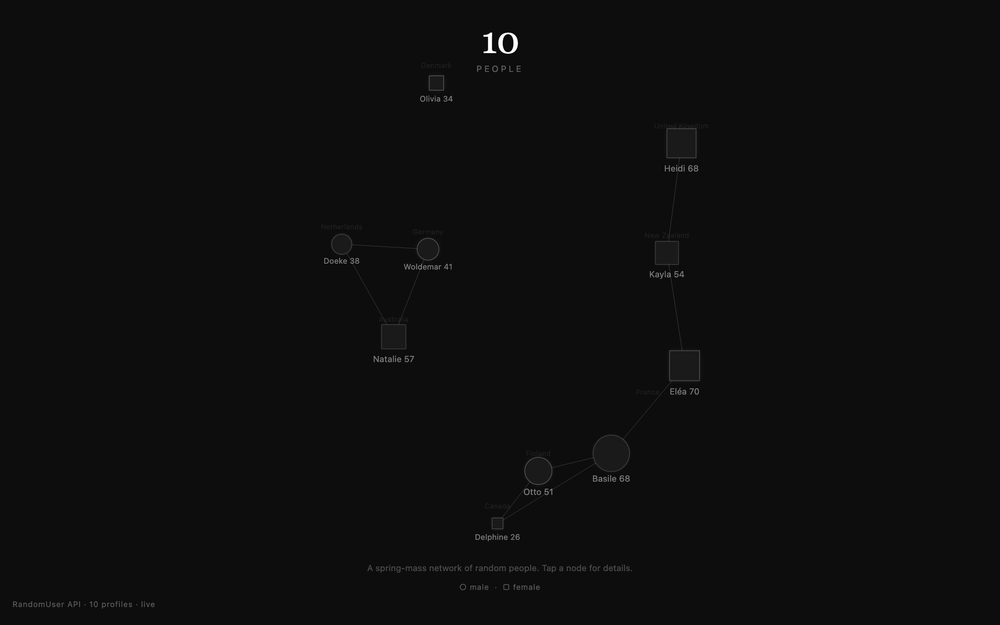

<div align="center">

<h1>nodes</h1>

<p><b>A spring network of ten strangers.</b></p>

<p><i>Ten generated people from the RandomUser API, pulled into place by springs and grouped by country.</i></p>

<h6>


</h6>

<a href="https://parthchandak02.github.io/nodes/"><b>Live demo</b></a> ·
<a href="#how-it-works"><b>How it works</b></a> ·
<a href="#run-it"><b>Run it</b></a>

<br><br>

<a href="https://parthchandak02.github.io/nodes/"></a>

<sub>Live capture, 22 October 2026. The people are fake profiles generated by RandomUser, not real individuals.</sub>

</div>

<br>

Each node is a fictional person from [randomuser.me](https://randomuser.me), a free API that
generates fake user profiles. The page asks for ten of them, places each one near a centre
for its country, links any two that start within 200 px of each other, and lets a small
spring-mass simulation settle the network. Everything is drawn in grey on black in a
single HTML file with no libraries.

## How it works

| Profile field | Drives |
|---|---|
| `dob.age` | Node size: age 18 to 70 maps to a 6 to 24 px radius |
| `gender` | Node shape: circle for male, square for female |
| `location.country` | Starting position: countries are spaced around a ring, with a faint label at each group |
| `name.first` + `dob.age` | The label beside every node, usually under it, moved when it would collide with another |

Springs pull linked nodes toward a 120 px rest length, every pair repels (inverse square),
and a weak pull keeps the whole network centred. 40 physics steps run before the first frame
so the page never opens on a pile of overlapping nodes.

Click or tap a node to open a panel with the profile's full name, age, country, generated
email and RandomUser portrait; it fades after three seconds. Press and hold for one second
to replace the network with five new people. If the API is unreachable the page falls back
to five built-in sample profiles and the stamp in the bottom-left says `fallback`.

## Run it

It is one static file. Open it directly, or serve the folder:

```bash
git clone https://github.com/parthchandak02/nodes.git
cd nodes
python3 -m http.server 8000   # then open http://localhost:8000
```

<details>
<summary><b>Project layout</b></summary>

```
index.html   Everything: config object C, physics, drawing, API fetch, detail panel
brief.md     The original creative brief: concept, palette and data-to-visual encoding
.nojekyll    Serves the folder as-is on GitHub Pages
```

All tunables (spring constant, damping, repulsion, radii, timings, API URL) live in the `C`
object at the top of the script.

</details>

<br>

<div align="center">
<sub>Built with the Canvas 2D API and plain JavaScript. Data from RandomUser.</sub>
</div>
